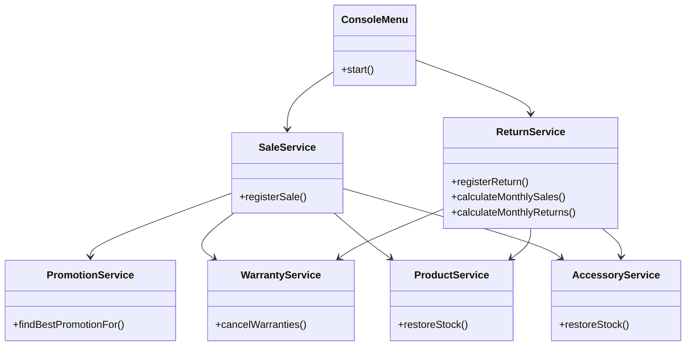

# GameZone Unicesar - System Integration Analysis

This document details the architectural analysis, adjustments, and integration process carried out for **Requerimiento 5: Sistema Integrado** of GameZone Unicesar. It covers the harmonious unification of the four independent modules: Accessories, Promotions, Warranties, and Returns.

---

## 1. Overview and Integration Scope

The goal of this phase is to merge four previously validated extensions into a single, cohesive layered architecture following standard principles:
* **UI Layer (`ui`)**: Console menus handling user interaction.
* **Service Layer (`service`)**: Business logic orchestration.
* **Persistence Layer (`persistence`)**: CSV file data management.
* **Model Layer (`model`)**: Core domain entities.

---

## 2. Integration Adjustments (A1 - A7)

### A1 - Accessory Category Discount
* **Type:** New Feature (`feature/accessory-category-discount`)
* **Cause & Context:** Requirement 2 initially limited `CategoryDiscount` targets to `"VIDEOGAME"` and `"CONSOLE"`. With accessories integrated, promotions must also target accessories.
* **Applied Solution:**
  * Updated `CategoryDiscount` to support `"ACCESSORY"` as a target category and recognize `Accessory` instances in `calculateDiscount`.
  * Modified `PromotionService.registerCategoryDiscount` to validate the new category option.
  * Enhanced `ConsoleMenu` to prompt for accessory category discounts.
  * Added a valid accessory category promotion in `data/promotions.csv`.

### A2 - Warranty Module Circular Dependency Correction
* **Type:** Bug Fix (`fix/warranty-circular-dependency`)
* **Cause & Context:** The integration created a circular reference cycle: `SaleService` $\rightarrow$ `WarrantyService` $\rightarrow$ `WarrantyRepository` $\rightarrow$ `SaleService`, preventing proper object creation via constructor injection in `Main`.
* **Applied Solution:**
  * Refactored `WarrantyRepository` to persist and load only raw identifiers (IDs) of sales and products, removing its direct dependency on `SaleService`.
  * Updated `WarrantyService` to resolve `Sale` and `Product` references dynamically using repositories.
  * Adjusted initialization order in `Main`.

### A3 - Unified Sale Registration Flow
* **Type:** Refactor (`refactor/unified-sale-registration`)
* **Cause & Context:** Requirements 1, 2, and 4 independently altered `SaleService.registerSale`. Order of operations was critical to ensure discounts, taxes, and warranties calculated correctly.
* **Applied Solution:** Reorganized `SaleService.registerSale` into a precise 8-step pipeline:
  1. Validate sale has at least one item.
  2. Resolve item type (product or accessory) and validate stock availability.
  3. Instantiate sale and compute subtotal.
  4. Query `PromotionService.findBestPromotionFor(sale)` and apply discount strictly on item subtotals.
  5. Generate console basic warranties and requested extended warranties, summing costs.
  6. Compute final total: $\text{Subtotal} - \text{Discount} + \text{Extended Warranty Cost}$.
  7. Update inventory via `ProductService` or `AccessoryService`.
  8. Persist sale and warranties.
  * Updated `Sale.generateReceipt` and `ConsoleMenu` UI flows.

### A4 - Accessory Stock Return Management
* **Type:** Bug Fix (`fix/return-accessory-stock`)
* **Cause & Context:** Requirement 3 restored stock exclusively through `ProductService.restoreStock`, failing to handle accessory inventory changes.
* **Applied Solution:**
  * Added `restoreStock(String accessoryId, int quantity)` to `AccessoryService`.
  * Updated `ReturnService` to accept `AccessoryService` via constructor injection and delegate stock restoration based on item type.
  * Adjusted `ReturnRepository` to properly resolve accessory references during data load.

### A5 - Discounted Sale Refund Adjustment
* **Type:** Bug Fix (`fix/return-discounted-refund`)
* **Cause & Context:** `Return.calculateRefundAmount` summed list prices of returned items, meaning discounted sales resulted in over-refunds.
* **Applied Solution:**
  * Modified `Return.calculateRefundAmount` to compute item refunds proportionally: $\text{Item Price} \times (1 - \frac{\text{Discount}}{\text{Subtotal}})$.
  * Updated `Return.generateReturnReceipt` to display list prices, proportional discounts, and net refunded amounts.

### A6 - Monthly Balance Report Correction
* **Type:** Bug Fix (`fix/monthly-balance-report`)
* **Cause & Context:** Requirement 3 required total sales, total returns, and net balance, but `generateMonthlyBalance` previously returned only the net balance. Additionally, final sale totals must account for discounts and warranties.
* **Applied Solution:**
  * Added `calculateMonthlySales(int month, int year): double` and `calculateMonthlyReturns(int month, int year): double` to `ReturnService`.
  * Configured `generateMonthlyBalance` to calculate net difference using final sale totals.
  * Updated `ConsoleMenu` to present all three metrics clearly.

### A7 - Warranty Cancellation upon Console Return
* **Type:** New Feature (`feature/return-warranty-cancellation`)
* **Cause & Context:** Returned consoles cannot retain active warranties. 
* **Applied Solution:**
  * Added `cancelWarranties(String productId, String saleId): double` to `WarrantyService` to remove warranty records and return refundable costs ($0$ for basic, additional fee for extended).
  * Integrated this call into `ReturnService.registerReturn` for returned consoles, adding warranty refunds to the total reimbursement.
  * Updated `Return` entity and receipt formats.

---

## 3. System Architecture & Class Diagram Summary

The integrated system respects strict layering rules (`ui` $\rightarrow$ `service` $\rightarrow$ `persistence` $\rightarrow$ `model`). 

---

## 4. Verification Scenario

The system has been verified using the mandatory acceptance script:
1. Register a sale containing a console, a videogame, and an accessory.
2. Confirm best active promotion is applied automatically with detailed receipt breakdown.
3. Assign an extended warranty to the console and inspect active coverages.
4. Process a partial return for both the console and the accessory.
5. Verify restored stock levels, cancelled warranty status, and accurate proportional refund amounts.
6. Query and display the comprehensive monthly balance report.